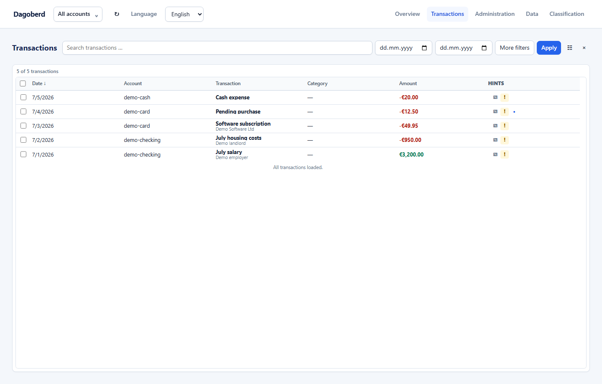

# Dagoberd

[](https://github.com/GrumpyKitten81/Dagoberd/actions/workflows/quality.yml)
[](LICENSE)
[](pyproject.toml)

Dagoberd is a local finance ledger with file imports, experimental read-only banking, receipt matching, classification and reproducible reports. Use the local web interface, CLI or an optional MCP client to explore your finances; personal report modules and workflows can live in a separate private repository. Version `0.3.0b1` is a public-beta candidate for technically experienced individual users.

## Try the demo in two minutes

Install Python 3.12+ and Poetry 2.2+, then run from this checkout:

```bash
poetry sync
poetry run dagoberd demo create
poetry run dagoberd --config .dagoberd/demo/dagoberd.toml gui
```

The browser opens a separate workspace containing synthetic data. The demo needs no bank credentials, external model or private partner repository. Dependency installation time depends on your connection.



For your own workspace, the preferred setup is to start your coding agent, load the [Dagoberd skill](.agents/skills/dagoberd/SKILL.md), and follow the [agent-guided account setup](doc/AGENT_ACCOUNT_IMPORT.md). The agent helps select the workspace, review exports and configure repeatable imports with your approval. Authentication and secrets stay with you.

For manual setup, run `poetry run dagoberd setup --yes`, followed by `poetry run dagoberd self-test`. Setup preserves existing data paths and local extension settings. See the [Runbook](doc/RUNBOOK.md) for configuration and the full workflow; project documentation and CLI/report output are English. The GUI also supports German and Spanish through its language picker; first use is English and the chosen language is stored locally.

## Beta boundaries

Start your preferred coding agent separately and load the Dagoberd skill. Dagoberd does not choose that agent's model or credentials. Its optional OpenAI-compatible classifier uses separate local configuration and produces reviewable category suggestions; it has no web search or agent tools. See [Agent and LLM integration](doc/AGENT_LLM_INTEGRATION.md) for the division of work, CLI/MCP flow and privacy boundaries.

- File imports from CSV, XLS/XLSX and CAMT.053 are the recommended workflow. The strictly read-only Comdirect API is experimental and incomplete: savings-account coverage is not verified and Visa credit-card transactions are unavailable. APIs for other banks are not currently offered; broader API coverage is future work.
- No payments, bank-side changes, portfolio management or financial advice.
- One user and multiple isolated workspaces; no hosted service or multi-user operation.
- External LLMs are disabled by default. Local classification is restricted to loopback; remote endpoints require cloud opt-in and an exact payload preview bound to endpoint and request configuration. Results remain suggestions until accepted. The calling agent's own data transfers follow its settings.
- Email delivery requires a preview and local confirmation. Secrets use the OS keyring; ledger data, receipts and reports remain sensitive local files.
- Review classifications and report results before relying on them. This is beta software provided without warranty and is not financial, investment or tax advice. Keyring and deliberately enabled bank/model/SMTP integrations require local acceptance. Not every bank export layout is supported.

## Development and documentation

Install the `dagoberd` distribution and use `dagoberd` or `dagoberd-mcp`. Python integrations import `dagoberd`.

Run `poetry run pre-commit install` once after cloning. The unfiltered Quality workflow checks formatting, lint, types, the complete test suite and package builds on pull requests and pushes to `main`.

- [Product requirements](doc/PRD.md), [Runbook](doc/RUNBOOK.md) and [Design system](doc/DESIGN_SYSTEM.md)
- [CI and release checks](doc/GITHUB_ACTIONS.md), [Changelog](CHANGELOG.md) and [Contributing](CONTRIBUTING.md)
- [Agent guidance](AGENTS.md), [shared coding guidance](.agents/guidance/) and [Dagoberd skill](.agents/skills/dagoberd/SKILL.md)
- [Security](SECURITY.md), [Privacy](doc/PRIVACY.md), [Threat model](doc/THREAT_MODEL.md) and [Support](SUPPORT.md)
- [Third-party notices](THIRD_PARTY_NOTICES.md) and [Apache 2.0 license](LICENSE)

Report bugs, feature requests and security concerns through the matching public GitHub issue form. Use synthetic examples and sanitized diagnostics; never post credentials or real financial files.

## Separate private and business workspaces

Create an ordinary local folder with `dagoberd workspaces create <name> <directory>`,
initialize an existing folder with `workspaces init`, or register its configuration.
Git, GitHub and an internet connection are not required for local file-based workflows.
Select a workspace with `dagoberd --workspace <name> ...`; the GUI also provides a picker
and local management dialogs. Add local Git later with `workspaces git <name> init --yes`,
without creating a commit or remote. Independently, connect a private synchronized folder
with `workspaces sync <name> configure --root <folder> --yes` and explicitly exchange
verified snapshots. The live database stays local. See [multiple workspaces](doc/MULTIPLE_WORKSPACES.md)
for adoption on another machine, conflict handling, cloud files and optional Git remotes.
